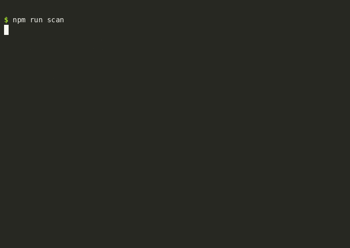

# Supply-Chain Sandbox

Before you trust a new version of a dependency, this tool checks it for known vulnerabilities and malicious behavior. It works on Python, npm, RubyGems, and Go projects. Python packages are also installed inside an isolated container, so their install-time behavior gets watched too.



*Recording of `npm run scan`. The clean example gets **PASS**. The simulated malicious example gets **BLOCK**.*

**Get started in three commands:**

```bash
git clone https://github.com/muhammadfaizan/supply-chain-sandbox.git
cd supply-chain-sandbox
npm run scan
```

The only hard requirement is **Docker**. Every scanner the tool uses runs inside Docker if it isn't installed on your machine.

---

## Contents

1. [The problem in plain words](#the-problem-in-plain-words)
2. [Key terms](#key-terms)
3. [Setup](#setup)
4. [Commands](#commands)
5. [Supported ecosystems](#supported-ecosystems)
6. [Scan your own project](#scan-your-own-project)
7. [Reading a report](#reading-a-report)
8. [What the scanner checks](#what-the-scanner-checks)
9. [How the isolation works](#how-the-isolation-works)
10. [Project layout](#project-layout)
11. [Troubleshooting](#troubleshooting)
12. [Limitations](#limitations)

---

## The problem in plain words

Modern software is built from many small libraries that other people wrote. When you run `pip install something`, `npm install something`, `gem install something`, or `go get something`, you run code written by strangers. Sometimes an attacker takes over a popular library, or publishes a lookalike with a similar name, and the new version steals passwords or API keys. This is a **supply-chain attack**.

This tool is a checkpoint. Before you accept an updated dependency:

1. It checks every dependency in your project against a database of published security problems.
2. It asks a malware-detection scanner whether any package matches known malicious patterns.
3. For Python packages, it installs the package inside a locked-down container with no internet access and no view of your files, and records everything the install tries to do.
4. It writes a report with a verdict: **PASS**, **WARN**, or **BLOCK**.

Nothing is merged or installed into your real project automatically. You read the report and decide.

## Key terms

| Term | Meaning |
|---|---|
| **Dependency** | A library your project uses, such as `requests` or `express`. |
| **Manifest** | A file that lists dependencies, such as `requirements.txt`, `package.json`, `Gemfile`, or `go.mod`. |
| **Lockfile** | A file that pins exact versions, such as `package-lock.json`, `Gemfile.lock`, or `go.sum`. |
| **Supply-chain attack** | Compromising a dependency so that everyone who installs it is attacked. |
| **Container** | A lightweight, isolated environment for running programs. Docker creates them. |
| **Image** | A packaged, reusable container template. This tool builds two: one for the sandbox, one for the scanners. |
| **Verdict** | The final answer: PASS, WARN (review it yourself), or BLOCK (do not install). |
| **Honeytoken** | A fake credential planted as bait. Reading it means something suspicious is happening. |
| **Example package** | A small package built for testing. The malicious one is harmless and only simulates an attack. |

## Setup

### What you need

| Requirement | Needed for | Required? |
|---|---|---|
| **Docker** | Everything: the scanners and the sandbox run in it | **Yes** |
| **Node.js** | The `npm run` shortcuts | No. `make` works without it |
| **Python 3.10+** | Running the command-line tool on your machine | Yes |
| **OSV-Scanner, GuardDog** installed locally | Speed | No. If missing, they run in Docker |

### macOS

```bash
brew install colima docker
colima start
```

`colima` is a lightweight Linux VM that runs Docker on a Mac. Node is optional: `brew install node` if you want the `npm run` shortcuts.

### Linux

Install Docker from your package manager or from docs.docker.com. Then confirm this works without `sudo`:

```bash
docker run --rm hello-world
```

### Check your setup

```bash
npm run doctor
```

This prints `[ok]`, `[missing]`, or `[skip]` for each requirement, and tells you how to fix anything missing.

## Commands

Run these from the `supply-chain-sandbox` folder.

| What you want | Command |
|---|---|
| Check your setup | `npm run doctor` |
| Build the two Docker images (optional; scanning does it for you) | `npm run build` |
| Scan the two built-in examples | `npm run scan` |
| Scan your own folder | `npm run scan -- ../my-project` |
| Scan several folders | `npm run scan -- ../my-lib ../my-app` |
| Only check some ecosystems | `npm run scan -- ../my-app --ecosystem npm` |
| Run the scanners in Docker even if they're installed | `npm run scan -- ../my-app --in-docker` |
| Run the test suite | `npm run test` |

**Prefer `make`?** The same commands exist as `make doctor`, `make build`, `make test`, `make scan`, and `make scan TARGET=../my-project`.

The first scan builds the scanner image, which takes a minute or two. The sandbox image is built the same way. Later scans reuse both images and start in seconds.

### What `npm run scan` prints

```
RESULTS
============================================================

PASS   clean-pkg
         full report: reports/clean-pkg.md

BLOCK  malicious-pkg
         - WARN (tool) guarddog (pypi): 2 suspicious heuristic(s) matched
         - WARN (static) setup.py: raw socket use
         - WARN (static) setup.py: credential path reference
         - BLOCK (dynamic) dns_lookup: evil.example.test
         full report: reports/malicious-pkg.md

Built-in examples: both behaved as expected.
```

The malicious example is **supposed** to be blocked, so that output means the tool is working. Full details for each run are in `reports/`.

## Supported ecosystems

The tool finds these files in your folder and checks each ecosystem it finds. You don't need to tell it what your project uses.

| Ecosystem | Files it looks for | Known vulnerabilities | Malware heuristics | Installed in the sandbox |
|---|---|---|---|---|
| **Python** (`pypi`) | `requirements*.txt`, `setup.py`, `pyproject.toml`, `Pipfile.lock`, `poetry.lock` | Yes | Yes | Yes, when there's a `setup.py` or `pyproject.toml` |
| **npm** (`npm`) | `package.json`, `package-lock.json`, `yarn.lock`, `pnpm-lock.yaml` | Yes | Yes | Not yet |
| **RubyGems** (`rubygems`) | `Gemfile`, `Gemfile.lock`, `*.gemspec` | Yes | Yes | Not yet |
| **Go** (`go`) | `go.mod`, `go.sum` | Yes | Yes | Not yet |

"Not yet" means the package is checked by reading it and by the vulnerability and heuristic scanners, but its install code isn't run in the sandbox. The report says so in its coverage table, so you always know which checks ran.

## Scan your own project

Point the scanner at the folder that contains your project's dependency files:

```bash
npm run scan -- ../my-project
```

It detects the ecosystems automatically. If your project has both a `requirements.txt` and a `package.json`, both are checked.

Useful options:

| Option | What it does |
|---|---|
| `--ecosystem npm` | Only check npm (or `pypi`, `rubygems`, `go`, or a comma-separated list). |
| `--in-docker` | Run OSV-Scanner and GuardDog in Docker, even if they're installed locally. |

**Exit codes**, for scripts and CI:

| Code | Meaning |
|---|---|
| `0` | Every folder passed or only got warnings. |
| `1` | At least one folder was blocked, or a scan failed. |
| `2` | Usage error, such as a folder that doesn't exist or has no dependency files. |

## Reading a report

Each scan writes a Markdown report. Here is the coverage table and findings from the multi-ecosystem example, trimmed:

```markdown
# Dependency screening report

- Target: `fixtures/multi-ecosystem`
- **Verdict: WARN**

## Coverage

| Ecosystem | Manifests found | Known vulnerabilities | Heuristics | Install in sandbox |
|---|---|---|---|---|
| go | `go/go.mod`, `go/go.sum` | checked 1 package | no risks detected | not supported yet (static only) |
| npm | `node/package-lock.json`, `node/package.json` | checked 1 package | no risks detected | not supported yet (static only) |
| pypi | `python/requirements.txt` | checked 4 packages | no risks detected | skipped: no setup.py or pyproject.toml to install |

## Findings
- **WARN** (static) lodash 4.17.15 (npm): 5 known vulnerabilities, e.g. GHSA-29mw-wpgm-hmr9, ...
- **WARN** (static) requests 2.19.0 (pypi): 10 known vulnerabilities, e.g. PYSEC-2018-28, ...
```

Read it from top to bottom:

1. **Verdict** is the answer. Start here.
2. **Coverage** shows what was checked for each ecosystem. If a check says `skipped` or `error`, that part of your project was not verified.
3. **Findings** are the reasons. Each has a severity and a stage:
   - **BLOCK**: the package did something dangerous during an install in the sandbox.
   - **WARN**: something that deserves a look. Known vulnerabilities land here, because the fix is usually to upgrade, not to abandon the package.
   - **INFO**: context only. It doesn't affect the verdict.
   - **Stage**: `static` (read from files; nothing ran), `dynamic` (observed during a sandbox install), or `tool` (from an external scanner).
4. **Runtime events** is the raw log of what a sandbox install did. Use it as evidence.
5. **Tool notes** say which scanners ran, whether each ran locally or in Docker, and anything that was skipped.

### What to do with each verdict

| Verdict | Meaning | What to do |
|---|---|---|
| **PASS** | Nothing suspicious found in the checks that ran. | Proceed with your normal review. |
| **WARN** | Known vulnerabilities, or something unusual that isn't clearly malicious. | Upgrade to a fixed version if one exists. Read the findings. Check the package's changelog and maintainers. |
| **BLOCK** | Dangerous behavior during install, such as a network connection or a credential read. | Don't install it. If it's a real third-party package, report it to the registry. |

## What the scanner checks

### Known vulnerabilities (all ecosystems)

[OSV-Scanner](https://google.github.io/osv-scanner/) reads the dependency files and compares each version against published security advisories. A WARN here means the version has known problems. The report lists the advisory IDs, which you can look up.

### Malware heuristics (all ecosystems)

[GuardDog](https://github.com/DataDog/guarddog) checks package code for patterns that match known malicious packages, such as obfuscated payloads or install scripts that fetch remote code.

### Source-code checks (Python only)

These read the Python code without running it:

| Check | Why it matters |
|---|---|
| `setup.py` present | Installing this package runs Python code. Shown as INFO, since most packages have one. |
| Raw socket use | Code that opens network connections directly. |
| Outbound HTTP clients | Code that talks to web servers. Common in legitimate libraries, so it's a WARN. |
| Process spawning | Code that starts other programs. |
| `eval`, `exec`, base64 decoding | Common in obfuscated malware. |
| Credential paths (`~/.ssh`, `~/.aws`, `.env`) | Code that looks for passwords or keys. |

### Install-time behavior (Python only, in the sandbox)

These checks run only when the Python package is actually installed in the container:

| Event | Verdict effect |
|---|---|
| Network connection attempted | **BLOCK** |
| Name lookup (DNS) for a website | **BLOCK** |
| Reading a sensitive file (credentials, keys) | **BLOCK** |
| Writing outside the work folder | WARN |
| Starting an unexpected program | WARN |

Normal build steps are allowed. Setup tools routinely check the operating system or start a helper Python process, so those don't raise findings.

## How the isolation works

The sandbox has several layers. If one fails, the others still protect you.

| Layer | What it does | Protects against |
|---|---|---|
| **No network** | The sandbox container cannot reach the internet. | Stealing data, downloading more malware |
| **Read-only system** | The container's system files cannot be changed. | Permanent tampering |
| **No privileges** | All Linux capabilities are removed and privilege escalation is blocked. | Breaking out of limits |
| **Unprivileged user** | Runs as user ID 10001, not root. | Writing to protected places |
| **Limited writable space** | Only `/tmp` and `/work`, both size-capped. | Filling your disk |
| **Resource limits** | Caps on memory, CPU, and processes. | Runaway or fork-bomb code |
| **Only your folder is shared** | The folder being scanned is mounted read-only. Your home folder is not visible. | Reading your files, SSH keys, cloud credentials |
| **Honeytoken** | A fake `.env` file inside the sandbox. | Detecting credential theft |
| **Runtime monitor** | Records network, file, and process activity. | Hiding what happened |

The scanner container (for OSV-Scanner and GuardDog) uses the same read-only, unprivileged, no-capabilities setup. It can reach the internet, because OSV-Scanner needs to download the vulnerability database.

**What Docker alone doesn't cover:** containers share the host's operating system kernel. A specially crafted attack on the kernel could escape a container. Ordinary malicious packages don't do that; they steal credentials and send them over the network, which these layers stop. For code that might attack the kernel, add [gVisor](https://gvisor.dev/) or run each scan in a throwaway virtual machine.

## Project layout

```
package.json                 npm commands: doctor, build, test, scan
Makefile                     the same commands for make users
Dockerfile                   sandbox image: non-root user, honeytoken, runtime monitor
Dockerfile.tools             scanner image: OSV-Scanner and GuardDog, pinned and checksum-verified
docs/
  demo.sh                    script used to record the demo GIF
  demo-scan.gif              the recording at the top of this file
monitor/
  sitecustomize.py           runtime monitor, loaded in every Python process in the sandbox
scripts/
  sandbox.py                 command entry point: doctor, build, test, scan
  screen.py                  screening engine: detection, scanners, sandbox run, verdict, report
  run_sandbox.sh             starts the sandbox container with all the isolation flags
  sandbox-install.sh         runs inside the sandbox: copies the package, installs it
fixtures/
  clean-pkg/                 harmless Python package (expected: PASS)
  malicious-pkg/             simulated attack (expected: BLOCK). Never publish this.
  multi-ecosystem/           one vulnerable dependency file per ecosystem
tests/
  test_sandbox.py            tests for isolation, detection, and verdicts
reports/                     generated reports (not committed)
```

## Troubleshooting

Start with `npm run doctor`. It catches most setup problems.

**`Docker is installed but not running`**
Start Docker. On macOS, run `colima start`. On Linux, start the Docker service.

**`Docker is not installed`**
Follow the [Setup](#setup) steps for your system.

**`no supported dependency files found`**
The folder doesn't contain any of the files listed in [Supported ecosystems](#supported-ecosystems). Check the path. You may be pointing at the wrong folder.

**`no npm files found`** (or similar, with `--ecosystem`)
You asked for an ecosystem the folder doesn't contain. Remove `--ecosystem`, or pick one that's present.

**`toolbox image could not be built`**
The scanner image needs internet access to download OSV-Scanner and GuardDog during the build. Check your connection, then run `npm run build` to see the full error.

**`npm: command not found`**
Install Node.js (`brew install node`), or use the `make` commands, which don't need Node.

**The first scan is slow**
That's the one-time image build. Later scans reuse the images. To rebuild on purpose, run `npm run build`.

**`not a folder: ...`**
The path you passed doesn't exist. Relative paths are resolved from the `supply-chain-sandbox` folder.

**`BLOCK` shows up but the command exits with `0`**
That's expected for the built-in examples. With no path, `npm run scan` checks that the malicious example is blocked and exits `0` when it is. If you scan your own folder and get `BLOCK`, the command exits with `1`.

**The report says `sandbox run failed`**
The most common causes are Docker not running or the sandbox image not being built. Run `npm run doctor`.

## Limitations

These are the honest edges of the current version:

- **Install-time behavior is only checked for Python.** npm, RubyGems, and Go packages get the vulnerability and malware-heuristic checks, but their install code isn't run in the sandbox yet. Their coverage rows say so.
- **The monitor runs inside the same Python process as the package.** A package that deliberately turns off Python's audit hooks would evade the runtime monitor. The container restrictions still apply in that case.
- **Sandbox installs are offline.** Packages are installed from a local folder. Downloads from a package registry would need a proxy that allows only that registry, which isn't built yet.
- **The sensitive-path list is hand-written.** It covers common credential locations. It is not exhaustive.
- **Some checks are heuristics.** A legitimate networking library can trigger a WARN. Treat WARN as "look at this", and BLOCK as "don't install this".
- **This doesn't replace code review or Dependabot.** It's one more check, and it looks at dependency versions and install-time behavior, not every line of code.
